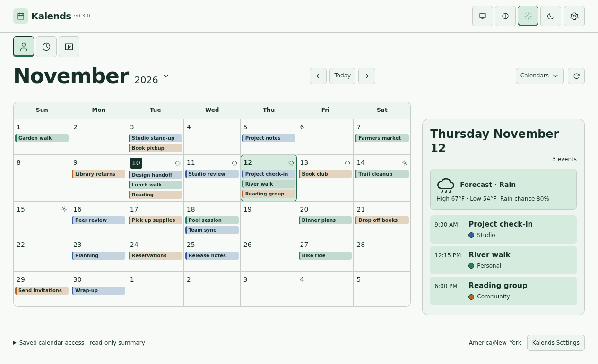
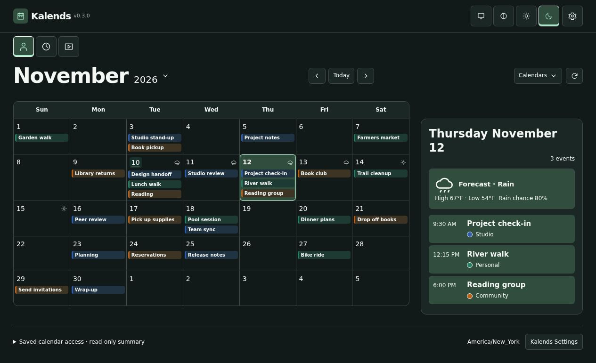

# Kalends

Kalends puts your iCloud calendars in the Hermes Desktop sidebar. Pick a day to see what's on it, then click an event for the details. You can hide a calendar from the view without revoking access to it.

It's an unofficial plugin, not an Apple product.

## Quick start

1. In Hermes Desktop, open **Capabilities → Plugins → Install from Git**. Paste `https://github.com/Anunnaki-Astronaut/kalends` and review the install. Install **Desktop** on your computer and **Agent** on the Hermes backend you use. If Hermes runs locally, that's the same machine.
2. Open **Kalends** in the sidebar, then click the gear. In **Accounts**, click **Set up iCloud account**. Enter your Apple Account sign-in and an [app-specific password](https://support.apple.com/en-us/102654) in **Agent settings**, not in chat.
3. Return to **Kalends Settings** and click **Test and discover calendars**. Turn on **Read** for the calendars you want to see. Click **Save calendar access**, then go **Back to Calendar**.

[Full setup guide](docs/INSTALL.md) · [Using Kalends](docs/INSTALL.md#use-the-calendar) · [Troubleshooting](docs/INSTALL.md#troubleshooting)

Kalends works with one iCloud account per Hermes profile. You can use it as a plain calendar or add a forecast, show Sonarr and Radarr dates, and see when selected Hermes jobs are due. [Set up those extras](docs/INSTALL.md#optional-views) only if you want them.

## Screenshots

The screenshots use fictional events. They aren't from a signed-in account.

| Light | Dark |
| --- | --- |
|  |  |

[See Kalends Settings and Theme Maker](docs/screenshots/settings.png).

## Security and privacy

Hermes stores your sign-in and app-specific password in the selected backend profile. The backend sends them to iCloud over HTTPS. The sidebar receives calendar results, not your password, and only shows events from calendars you've granted **Read**. If you ask Hermes to use its calendar tools, event details can enter the conversation and reach the model provider for that session.

The sidebar can't edit events. Hermes Agent can create, edit, or delete eligible events if you grant that permission for the calendar, ask for the change, and confirm it. The move tool creates and checks a copy without deleting the original.

Forecasts and media feeds are off until you turn them on. Pirate Weather receives the coordinates you enter and your key over HTTPS. The backend uses your feed URL to request data from your Sonarr or Radarr server on the private network. The URL contains a credential, which travels without encryption if you allow plain HTTP. Automations reads schedules from your Hermes profile; it doesn't run or change jobs.

Kalends saves calendar permissions, selected jobs, and records of write operations (including event resource addresses) in the backend profile. It doesn't archive event bodies. Appearance preferences stay on the Desktop device. Don't attach real calendar exports, credentials, feed URLs, or screenshots of private data to a bug report.

## Known limits

If a calendar shows an incomplete-results warning, check those dates in Apple Calendar. Kalends can skip some timed events that start and end at the same moment. Other unsupported events can still stop a calendar read. Granting **Edit** won't help Kalends read an event.

[Changelog](CHANGELOG.md) · [Development](docs/DEVELOPMENT.md) · [Report a security issue](SECURITY.md) · [MIT license](LICENSE)
